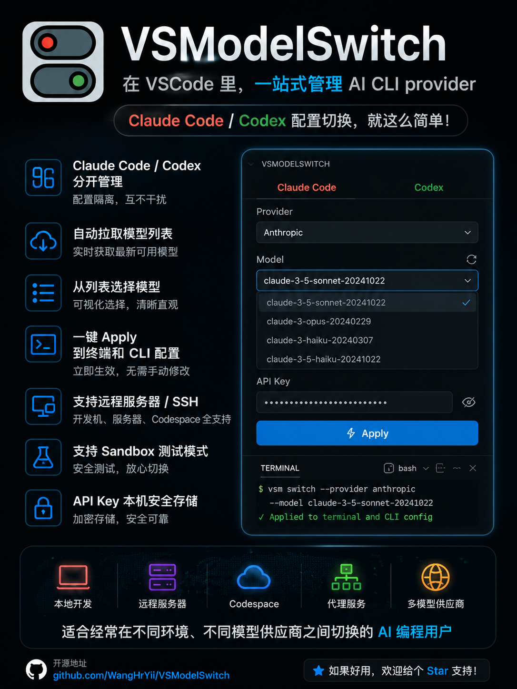

# AgentDeck

本次发布的 Codex 专项验收、宿主机测试步骤与换账号接手开发，请阅读[宿主机验收](docs/host-acceptance.md)及[开发交接入口](docs/development-handoff.md)。仓库目录改为 `AgentDeck`；内部扩展身份和已有用户数据保持不变。

**0.10.0** adds Codex provider groups, empty groups, drag ordering, environment-local availability, reusable request templates and v2 configuration exports/imports. Registered client controllers and views provide an extension point for additional agents. Existing providers and shared API history are preserved. See [client architecture and groups](docs/client-architecture.md).

**0.9.4** places network actions directly below the proxy badge and clarifies the overview legacy-route label as pending reapplication. Configuration status is distinct from connectivity testing; installation, refresh and transport testing do not migrate client settings.

**0.9.3** fixes Chinese native confirmations even with an English VS Code locale, adds explicit Chinese cancellation actions, and localizes folder selection, speed progress and user-facing error explanations while preserving raw diagnostic logs. Controls owned by VS Code itself still follow the editor locale.

**0.9.2** uses the confirmed name **AgentDeck** throughout extension titles, commands and UI. Internal extension identity, existing settings and stored data remain unchanged; the interface remains Chinese-first.

**0.9.1** adopts the display name AI 客户端管家 (AI Client Hub), defaults to a Chinese UI, moves network test/apply/restore controls before the draft fields, and removes the duplicate API configuration path. Extension identity, storage keys and existing data are preserved. Network clipboard data contains the proxy entry, bypass list, note and tool flags; pasting fills the current tool draft without applying it.

**0.9.0** reorganizes Codex overview, storage, networking and account/API management. It adds scoped timed feedback, reload severity, in-editor log browsing, selectable history backup deletion, and consistent Codex-only provider exports/imports. Claude networking covers the extension and normal CLI using the same configuration directory without mutating the extension host environment. Codex uses an **experimental Linux dispatcher**; mixed Windows/WSL clients are not supported yet. Read [networking](docs/network-proxy.md) before enabling and [development status](docs/development-log.md) for platform gaps.

Earlier releases:


**0.8.1** unifies the Codex page, puts storage below overview, keeps operation results beside their controls, and adds bounded environment-local operation logs with verified relocation. Impactful changes use one explicit confirmation instead of private task-status detection. [Management guide](docs/management.md).

0.6.0 adds **通过 VPN 联网 / Network proxy**: shared HTTP proxy settings for
Claude Code, Codex and the extension's outgoing API/model/speed requests.
It is off by default, supports connection testing and Apply/Restore, and keeps
the existing API compatibility proxy independent. The current host-network
container can use `http://127.0.0.1:12000` without Docker network changes.
Restart clients while TUN remains on, then separately verify real chat with the
host VPN in system-proxy mode. See [network proxy](docs/network-proxy.md).

0.5.0 adds **Quick Speed Test** (one request), **Standard Speed Test** (three serial
requests), local metric reports and **Copy AI Speed Query**. API Providers use
their saved connection; official Codex uses a temporary session. Tests use quota;
reading results does not. See [speed tests and AI queries](docs/speed-benchmark.md).

Claude and Codex API providers support a native TypeScript **Built-in proxy** with a
justdowork preset and per-provider advanced overrides. Configure it in Add
Provider or an existing provider's Config editor; Save retains upstream
configuration, and Apply generates the local client endpoint. No Python is
required. Local running state and upstream model failures are shown separately.
Plugin requests carry the tool identity and use its own proxy or direct transport. Codex native launch still uses the editor HTTP proxy, which can affect other extensions; Claude launch variables are separate.
The overview shows **Tool / Mode / Provider Name / Model ID / Status**. Official
Codex login is shown independently of saved API providers, with **Signed in** or
**Login required**, and **Client default** when the client chooses its model.
The Codex section displays its current mode and two buttons: **Use Official
Account** and **Apply API Provider**. Official mode keeps cached authentication. Before replacing a signed-in official configuration with API settings, select a managed API identity; API mode then writes the selected provider. The official button is disabled while official mode is
already active, preserving the existing login. Codex
API provider configuration follows the same editor flow as Claude Code.
Both Config editors expose connection mode, presets, authentication, headers,
parameters, stream/tool processing, limits, retries, timeout and web tools.
Codex defaults to native OpenAI Responses and can explicitly translate to an
Anthropic Messages upstream. Numeric thinking budgets require Anthropic;
Responses uses `reasoning.effort`. See the protocol details below before choosing.

See [native proxy usage and lifecycle](docs/native-proxy.md) and
[third-party license notices](THIRD_PARTY_NOTICES.md). Release changes and
validation are recorded in the [changelog](AI_Prompt/03-功能更新记录.md) and
[validation guide](docs/validation.md).

English | [简体中文](README.zh-CN.md)

AgentDeck is a VS Code extension for maintaining and switching Claude
Code and Codex API providers. Provider metadata is managed in one sidebar while
API keys remain in VS Code SecretStorage until a provider is applied.

Repository: [XinZhaoDC/VSCodeModelSwitch](https://github.com/XinZhaoDC/VSCodeModelSwitch)

This private derivative is maintained independently from the original
VSModelSwitch project. Its MIT license and attribution are preserved in
[`LICENSE`](LICENSE).

<p align="center">
  
</p>

## What It Does

- Keeps Claude Code and Codex providers, active states, and tool locks separate.
- Adds providers from key fields or a complete JSON/TOML configuration.
- Fetches model suggestions when `/models` is supported, while still allowing a
  manual or empty Model ID.
- Applies a provider by backing up and fully replacing the selected CLI config.
- Matches the applied provider by normalized Base URL plus API key; a trailing
  `/v1` does not create a different identity.
- Edits stored provider configuration and secrets before Apply.
- Provides on-demand network, model compatibility, and optional usage checks.
- Imports and exports provider metadata with API keys removed.
- Shows log and backup sizes and provides scoped deletion controls.

## Requirements And Installation

- VS Code 1.96 or newer.
- Node.js 22 is recommended when building from source.
- Claude Code and/or Codex must be installed separately to use their terminals.

Install a locally built release through:

```text
Extensions -> ... -> Install from VSIX...
```

Select `vscodemodelswitch-<version>.vsix`, then run:

```text
Developer: Reload Window
```

## Safe First Run

Apply fully replaces a target configuration, so test in sandbox mode first.
Open `Preferences: Open Workspace Settings (JSON)` from the Command Palette and
set:

```json
{
  "vscodemodelswitch.globalCliSync": true,
  "vscodemodelswitch.configTarget": "sandbox",
  "vscodemodelswitch.testHome": ""
}
```

The default sandbox location is:

```text
<workspace>/.vscodemodelswitch-home/
```

Real mode targets the effective user home:

```text
~/.claude/settings.json
~/.codex/config.toml
```

Claude retains its previous-file backup. Codex keeps only a temporary operation recovery point and optional manual history backups:

```text
~/.claude/vscodemodelswitchbak/
Codex: temporary .recovery/ for the current operation; manual history snapshots in ai_client_data/codex/backups/
```

The same relative layout is used under the sandbox home.

## Usage

### 1. Enable A Tool

Open the AgentDeck Activity Bar view. Each Claude/Codex section has an
`Enabled` operation lock and a collapse control. Disabling a tool prevents
changes while `Applied Config` remains available for inspection.

### 2. Add A Provider

`Key fields` mode requires only:

- Tool
- Name
- Base URL
- API Key

`Fetch Models` loads suggestions when the provider implements a compatible
models endpoint. Failure is only a warning: enter a Model ID manually or leave
it empty. An empty model is displayed as `NULL` and can be configured later.
`Set active after saving` is off by default.

`Full configuration` mode starts from the complete Claude JSON or Codex TOML
template. Fill the Base URL and API key in their defined locations, then edit or
remove any other fields as needed. Model and Claude `effortLevel` may be empty
or omitted. Duplicate JSON/TOML fields are rejected.

Recognized key locations are:

```text
Claude: env.ANTHROPIC_AUTH_TOKEN
Codex:  model_providers.OpenAI.experimental_bearer_token
```

The key is removed from stored/exported configuration text and saved in
SecretStorage. Apply necessarily writes it into the selected Claude/Codex CLI
config file so those tools can authenticate.

### 3. Apply And Edit

- `Apply`: back up and fully replace only that tool's selected config file.
- `Config`: edit the stored complete configuration and key before applying it.
- `Model`: refresh suggestions and update the stored model.
- `Delete`: remove provider metadata and stored secrets after confirmation. It
  does not remove the already applied CLI config or backups.
- `Applied Config`: open the file currently used for status matching.

The global table shows Tool, Mode, Provider Name, Model ID and Status. API
status can be `Off`, `Unactivated`, `Ready`, `Key missing`, `Models stale`,
`Degraded` or `Network error`. Official Codex status is `Signed in` or
`Login required`, independently of saved API providers. An unspecified active
model displays `Client default`; a missing provider displays `Not configured`.
Provider cards still display `NULL` for an unset model. `Signed in` means local
login credentials exist; it does not check their remote expiry.

### 4. Network And Usage

- `Network & Usage` checks basic reachability and models endpoints. Tool-level
  checks run at most two providers concurrently and can be cancelled.
- `Verify Model` sends a minimal `/v1/messages` (Claude) or `/v1/responses`
  (Codex) request. It may consume a very small amount of API quota.
- Usage is optional. `Auto Detect` tries common same-origin balance endpoints
  for up to 20 seconds. Many relays do not expose balance through a model API
  key; New API-style services require a separate Management Access Token and
  User ID. A failed usage query does not mean model requests are unusable.

VSCodeModelSwitch uses the network route of the remote/container extension host.
VPN TUN routing therefore depends on the container's DNS and route, not only on
whether the host browser can open a provider website.

### 5. Logs, Backups, Import And Export

Open `View -> Output` and select `VSCodeModelSwitch` for sanitized request
diagnostics. Logs never include API keys or raw response bodies. The global
status area shows the current extension log-folder size and backup sizes.

`Delete Log` removes only this extension's current log files. Claude retains its `Delete Backups` action. Codex uses the storage panel for manual history backups and clears successful operation recovery data; existing old `.bak` files are retained. Deletion requires confirmation.

`Export` writes full provider templates and metadata but clears API keys and
management tokens. `Import` rejects duplicate provider names within the same
tool. Imported providers require keys to be entered locally through `Config`.

## Build From Source

Use the lockfile for reproducible dependencies:

```bash
npm ci
npm run check
npm run compile
npm run package
```

Generated artifacts are ignored by Git:

```text
node_modules/
out/
*.vsix
.vscodemodelswitch-home/
```

The container-specific Node environment and VSIX workflow are documented in
[`AI_Prompt/01-独立环境安装与VSIX构建.md`](AI_Prompt/01-独立环境安装与VSIX构建.md).

## Local Sandbox Test

1. Configure sandbox mode as shown above.
2. Start the local endpoint in a separate terminal with `npm run mock:models`.
3. Add Claude with Base URL `http://localhost:8787` and key `test-key`.
4. Fetch or enter `claude-sonnet-4-20250514`, save without auto-activation, and
   click `Apply`.
5. Repeat for Codex with `gpt-5-codex`.
6. Confirm the generated files exist below `.vscodemodelswitch-home/` and match
   the selected providers.
7. Run `Network & Usage` on both providers. For complete Verify Model/proxy
   protocol checks, run `npm run test:proxy` and `npm run test:codex-proxy`;
   `mock:models` is a minimal model-list/usage fixture, not a full SSE model.
8. Apply a second time and confirm backup size increases.
9. Export configuration and verify that `test-key` is absent.
10. Delete a provider and confirm the applied file remains unchanged.

The complete regression checklist is in [`docs/validation.md`](docs/validation.md).

## Security Notes

- Never commit exported files without inspecting them, even though normal Export
  removes recognized secrets.
- API keys are intentionally written into CLI configs on Apply; protect the
  effective home and backup directories accordingly.
- Usage auto-detection only derives paths on the configured provider origin. It
  does not send credentials to unrelated domains.
- The optional proxy reports local request outcomes. Authoritative billing and
  remaining quota still require the provider's usage API.

## License

MIT

## Codex 0.8.1

Codex now separates official accounts, API Providers and data storage. Account history is shared through a selected `ai_client_data/codex` folder; configuration and login caches remain private to each environment and account. Native Codex Chats displays the history. A global refresh reads shared data without applying another environment’s settings. Impactful changes require one explicit confirmation and retain operation recovery; installation and real-account acceptance remain manual. See [management guide](docs/management.md) for migration, Windows limits and recovery. Claude Code UI remains unchanged.
