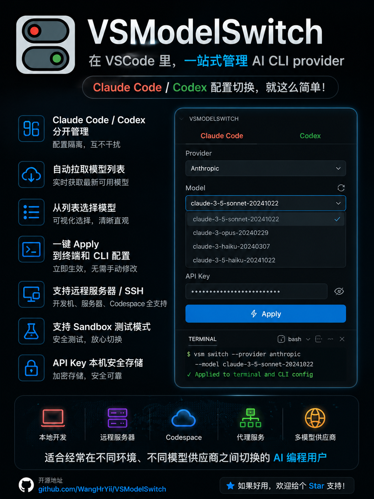

# AgentDeck

本次发布的 Codex 专项验收、宿主机测试步骤与换账号接手开发，请阅读[宿主机验收](docs/host-acceptance.md)及[开发交接入口](docs/development-handoff.md)。仓库目录改为 `AgentDeck`；内部扩展身份和已有用户数据保持不变。

**0.10.0** 新增 Codex API 供应商群组、空群组、两级拖动排序、环境独立禁用、可复用请求处理模板和 v2 配置导入导出。客户端控制器与页面按模块注册，支持后续接入其他客户端；既有供应商和 API 共享历史保留。详见[客户端架构与群组说明](docs/client-architecture.md)。

**0.9.4** 网络操作按钮紧接“已配置代理”状态下方；总览将模糊的“旧版配置”明确为“旧网络配置，待重新应用”，并区分配置核查异常。该状态反映保存的配置方式，不代表测试结果；安装、刷新或测试连接不会自动迁移运行配置。

**0.9.3** 补齐弹窗中文：账号/目录/网络变更确认固定中文，不再跟随英文 VS Code；删除和启用确认使用明确的中文取消按钮。目录选择、测速进度和错误说明同步调整，诊断日志规则保持不变。VS Code 自身的部分系统控件仍由编辑器语言决定。

**0.9.2** 采用正式名称 **AgentDeck**，同步更新扩展标题、侧边栏、菜单、状态栏和提示。界面仍以中文为主；内部扩展身份和既有配置、密钥、历史数据保持不变。

**0.9.1** 更名为“AI 客户端管家”（AI Client Hub），默认中文界面；网络模块的测试、启用与停用操作前置；移除 API 列表重复的配置路径。仅调整显示名称，内部扩展 ID、设置键和数据目录沿用，不需要迁移已有供应商或密钥。复制网络设置包含代理入口、绕过列表、备注和工具标记；粘贴改为当前工具草稿，须手动应用。

**0.9.0** 重排 Codex 总览、存储、网络和账号/API 模块；统一局部反馈、十秒提示、分级重载提醒、顶部日志浏览与历史备份选择删除。供应商导出格式统一，Codex 导入不影响 Claude。Claude 代理覆盖插件及同配置目录的正常 CLI，不修改扩展宿主环境变量。Codex 独立代理采用 **Linux 实验性启动入口**，同一客户端的 Windows/WSL 混合使用尚不支持；启用前请阅读[网络说明](docs/network-proxy.md)。[开发与平台日志](docs/development-log.md)记录未实现和未测试项目。

以下为历史版本记录：


**0.8.1** 统一 Codex 模块与折叠布局，数据与存储紧接总览；结果在操作区域显示绿框/红框，不自动跳转。操作日志有默认环境目录、校验搬迁、查看/导出/删除和轮换。影响运行的变更统一单次确认，替代任务状态检测。 详见[管理与迁移指南](docs/management.md)。安装本身不迁移用户数据。

0.6.0 新增 **通过 VPN 联网 / Network proxy** 面板：统一设置 Claude Code、
Codex 的聊天联网代理，并覆盖插件自身的 API 转发、模型查询和测速请求。
默认关闭，支持连接测试、应用与恢复；保留已有 API 兼容代理功能。
当前 host-network 容器可使用 `http://127.0.0.1:12000`，无需更改 Docker 网络。
应用后先保持 TUN 开启、重启客户端，再验证宿主机系统代理模式下的真实聊天。
连接测试通过不代表账号或聊天已验证。详见[网络代理说明](docs/network-proxy.md)。

0.5.2 统一 Network / Usage / Speed 为紧凑结果行，测速按钮恢复英文；
时间、DNS、端点与计量说明收进默认折叠的 **Details**，其中可找到 **Copy AI Speed Query**。
该按钮先选择工具，再复制读取其当前Provider本地测速记录的命令；不发起新请求、不监控当前会话。

0.5.0 新增 **Quick Speed Test**（1次请求）、**Standard Speed Test**（串行3次）、
本地指标报告和 **Copy AI Speed Query**。API Provider 使用保存的连接，官方 Codex 使用临时
会话。测速消耗额度，查询结果不调用模型。首字等待、生成阶段估算速度和全程吞吐分开显示；
缓冲重建流不显示原始生成速度。详见[测速与AI查询](docs/speed-benchmark.md)。

[English](README.md) | 简体中文

AgentDeck（原名 VSCodeModelSwitch）用于管理 Codex 与 Claude Code 的
官方账号、API 供应商、独立网络和本地历史目录。供应商定义集中显示在侧边栏；
API 密钥保存在 VS Code 安全存储中，应用供应商时才写入对应客户端配置。

代码仓库：[XinZhaoDC/AgentDeck](https://github.com/XinZhaoDC/AgentDeck)

这是从原 VSModelSwitch 项目派生并独立维护的私有版本。原项目的 MIT
许可证和署名保留在 [`LICENSE`](LICENSE) 中。

<p align="center">
  
</p>

## 功能概览

- 分开管理 Claude Code 与 Codex Provider、Active 状态和工具操作锁。
- 支持“关键字段”和“完整 JSON/TOML 配置”两种添加方式。
- Provider 支持编辑、排序、删除、切换模型和独立 Apply。
- `/models` 可用时加载模型建议，不可用时仍可手动输入或留空 Model ID。
- Claude Apply 保留原备份；Codex 使用操作恢复点替换当前环境配置。
- 按规范化 Base URL + API key 匹配已应用 Provider，末尾 `/v1` 不影响匹配。
- 提供按需网络检查、真实模型协议验证和可选额度查询。
- 导入和导出会清除 API key；SecretStorage 不参与导出。
- 显示插件日志；Claude 保留原备份管理，Codex 提供主动历史备份与临时操作恢复。
- Claude 与 Codex API Provider 均可选择 TypeScript 原生内置代理，无需 Python；提供 justdowork 预设和自定义上游设置。
- 两者 Config 共用连接模式、认证、请求头、参数覆盖、流与工具处理、历史/输出限制、重试、超时及网页工具。Codex 默认使用 OpenAI Responses，也可选择 Anthropic Messages 上游并转换协议；数字思考预算适用于 Anthropic，Responses 用附加参数中的 `reasoning.effort`。
- 添加及已有 Provider 的 Config 均可编辑代理；Save 后提示 Pending Apply，Apply 才更新实际连接。
- 单独显示本地代理状态和上游请求结果；支持代理详情、停止/重启与日志。
- 插件请求按工具使用独立的 HTTP 代理传输；未配置代理的工具请求直接发送。Codex 原生插件仍通过 VS Code HTTP proxy 启动，可能影响其他扩展；Claude 使用独立启动变量。
- 顶部状态表显示 Tool / Mode / Provider Name / Model ID / Status。官方账号独立显示 Official account、Signed in 或 Login required；未指定模型时显示 Client default，不依赖已保存的 API Provider。
- Codex 区域明确显示 Current mode，使用 Use Official Account 与 Apply API Provider 按钮。官方模式保留登录缓存；从已登录的官方身份切到 API 前，先启用并选择独立的 API 身份。API 模式再写入所选 API Provider。已处于官方模式时禁用官方切换按钮，保留现有登录。Config 编辑方式与 Claude Code 一致。

原生代理的字段、使用方式、窗口生命周期及验收边界见 [说明](docs/native-proxy.md)。适配模块沿用上游 PolyForm Noncommercial 许可，见 [第三方许可](THIRD_PARTY_NOTICES.md)。
版本变化见[功能更新记录](AI_Prompt/03-功能更新记录.md)，验证步骤见[验证指南](docs/validation.md)。

## 要求与 VSIX 安装

- VS Code 1.96 或更新版本。
- 从源码构建建议使用 Node.js 22。
- `claude`、`codex` CLI 需要根据实际用途另外安装。

通过 VS Code 图形界面安装本地构建包：

```text
扩展 -> ... -> 从 VSIX 安装...
```

选择 `vscodemodelswitch-<version>.vsix`，安装后运行：

```text
Developer: Reload Window
```

## 首次使用先开启 Sandbox

Apply 会完整替换目标配置，因此第一次测试不要直接使用 real。通过命令面板
运行 `Preferences: Open Workspace Settings (JSON)`，写入：

```json
{
  "vscodemodelswitch.globalCliSync": true,
  "vscodemodelswitch.configTarget": "sandbox",
  "vscodemodelswitch.testHome": ""
}
```

默认 sandbox 目录：

```text
<workspace>/.vscodemodelswitch-home/
```

real 模式使用当前扩展宿主所看到的用户 home：

```text
~/.claude/settings.json
~/.codex/config.toml
```

Claude 每次替换保留备份；Codex 仅在本次操作期间保存恢复点：

```text
~/.claude/vscodemodelswitchbak/
Codex: temporary .recovery/ for the current operation; manual history snapshots in ai_client_data/codex/backups/
```

Sandbox 使用相同的相对目录结构。

## 使用说明

### 1. 启用工具

打开活动栏中的 AgentDeck。Claude、Codex 各自拥有 `Enabled`
操作锁和折叠按钮。关闭 Enabled 后不能修改对应工具，但仍可打开
`Applied Config` 检查当前文件。折叠按钮会隐藏整个 Tool 面板。

### 2. 添加 Provider

`Key fields` 模式只要求：

- Tool
- Name
- Base URL
- API Key

`Fetch Models` 会在 Provider 支持模型列表接口时加载建议。失败只显示警告，
可以直接输入 Model ID，也可以留空。Provider 卡片中的空模型显示为 `NULL`，以后可通过
`Config` 或 `Model` 调整。`Set active after saving` 默认不勾选。

`Full configuration` 会提供完整 Claude JSON 或 Codex TOML 模板。必须在
规定位置填写 Base URL 和 API key，其他内容可以调整或删除。Model 和 Claude
的 `effortLevel` 可以为空或省略；重复 JSON/TOML 字段会被拒绝。

插件只识别以下 key 位置：

```text
Claude: env.ANTHROPIC_AUTH_TOKEN
Codex:  model_providers.OpenAI.experimental_bearer_token
```

保存 Provider 时，key 会从配置文本中清除并转存 SecretStorage。Apply 时必须
把 key 写回所选 Claude/Codex CLI 配置，否则 CLI 无法认证。

### 3. Apply、编辑与删除

- `Apply`：应用当前环境的目标配置；Claude 保留原备份，Codex 使用本次操作恢复点。
- `Config`：Apply 前编辑 Provider 的完整配置、API key 和 Usage 设置。
- `Model`：重新获取建议并修改保存的模型。
- `Delete`：确认后删除 Provider 元数据及其 SecretStorage key；不会删除已
  应用的配置和历史备份。
- `Applied Config`：打开当前用于匹配状态的实际配置文件。

顶部状态表显示 Tool、Mode、Provider Name、Model ID 和 Status。API 状态包括
`Off`、`Unactivated`、`Ready`、`Key missing`、`Models stale`、`Degraded` 和
`Network error`。官方 Codex 单独显示 `Signed in` 或 `Login required`，不依赖
API Provider。活动模式未指定模型时显示 `Client default`，没有 Provider 时显示
`Not configured`；卡片仍用 `NULL` 表示未设置模型。`Signed in` 只表示本地存在
登录凭据，不代表已在线检查会话有效期。

### 4. 网络、模型验证与 Usage

- `Network & Usage` 检查基础网络、Models API 和已启用的 Usage。工具级检查
  最多并发两个 Provider，并支持取消。
- `Verify Model` 对 Claude 发送最小 `/v1/messages` 请求，对 Codex 发送最小
  `/v1/responses` 请求，可能产生极少量 API 用量。
- Usage 默认关闭。`Auto Detect` 最多用 20 秒尝试同源常见额度端点。很多
  中转站不允许用模型 API key 查询账户余额；New API 类型还需要独立的
  Management Access Token 和 User ID。Usage 失败不代表模型不可用。

插件使用远程/容器 Extension Host 的网络路由。VPN TUN 是否生效取决于容器
DNS 和路由，不能只根据宿主机浏览器能否打开 Provider 网站判断。

### 5. 日志、备份与导入导出

通过 `视图 -> 输出` 打开输出面板，在右侧下拉列表选择
`VSCodeModelSwitch`。日志只记录端点、状态和 JSON 字段结构，不记录 API key
或原始响应正文。全局区域显示当前扩展日志目录和备份目录大小。

`Delete Log` 只删除本扩展当前日志目录的普通日志文件。Claude 保留原 `Delete Backups`；Codex 在数据与存储中主动备份历史，成功操作的临时恢复点会清理，已有旧 `.bak` 不自动删除。删除操作要求确认。

`Export` 保存完整 Provider 模板和元数据，但会清空 API key 与管理 Token。
`Import` 会拒绝同工具重名 Provider。导入后需要通过 `Config` 在本机重新填写
key。

## 从源码构建

使用锁文件安装依赖并依次检查、编译、打包：

```bash
npm ci
npm run check
npm run compile
npm run package
```

以下内容均为可重新生成的忽略项，不应提交 Git：

```text
node_modules/
out/
*.vsix
.vscodemodelswitch-home/
```

当前容器的独立 Node 环境和 VSIX 更新流程见
[`AI_Prompt/01-独立环境安装与VSIX构建.md`](AI_Prompt/01-独立环境安装与VSIX构建.md)。

## Sandbox 回归测试

1. 按上文把 Workspace Settings 设置为 sandbox。
2. 在独立终端运行 `npm run mock:models`，保持服务运行。
3. 添加 Claude：Base URL 为 `http://localhost:8787`，key 为 `test-key`。
4. 获取或输入 `claude-sonnet-4-20250514`，保持自动激活未勾选，保存后手动
   点击 `Apply`。
5. 添加 Codex，使用 `gpt-5-codex`，然后手动 Apply。
6. 检查 `.vscodemodelswitch-home/` 下两个配置文件是否与所选 Provider 一致。
7. 分别执行 `Network & Usage` 和 `Verify Model`。
8. 再次 Apply：Claude 保留原备份；Codex 成功后清理本次恢复点，不持续增加 `.bak`。
9. Export 后确认导出文件不包含 `test-key`。
10. 删除 Provider，确认已应用配置文件没有被删除或修改。

完整回归清单见 [`docs/validation.md`](docs/validation.md)。

## 安全说明

- 即使正常 Export 会清除已识别密钥，提交导出文件前仍应人工检查。
- Apply 会有意把 key 写入 CLI 配置文件，因此需要保护 effective home 和备份
  目录的访问权限。
- Usage Auto 只从当前 Provider origin 派生候选路径，不会把凭据发送到无关
  域名。
- 插件不实现 HTTP 代理，也不拦截 Claude/Codex 请求；Provider 没有 Usage API
  时，插件无法得出权威余额。

## License

MIT

## Codex 0.8.1

Codex 官方账号、API Providers 与数据存储分区；通过 `ai_client_data/codex` 按账号共享原生聊天历史，配置及认证缓存按环境、账号独立保存。历史在官方 Codex Chats 查看。全局刷新只读取共享数据和本环境状态；影响运行的配置修改统一单次确认并保留失败恢复，不再持续生成 Codex `.bak`。安装、真实登录和 Windows 跨系统挂载另行验收，Claude Code UI 保持。详见[管理与迁移指南](docs/management.md)。
